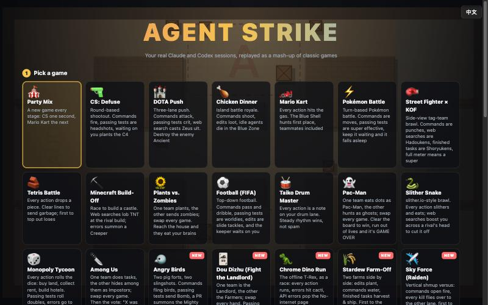
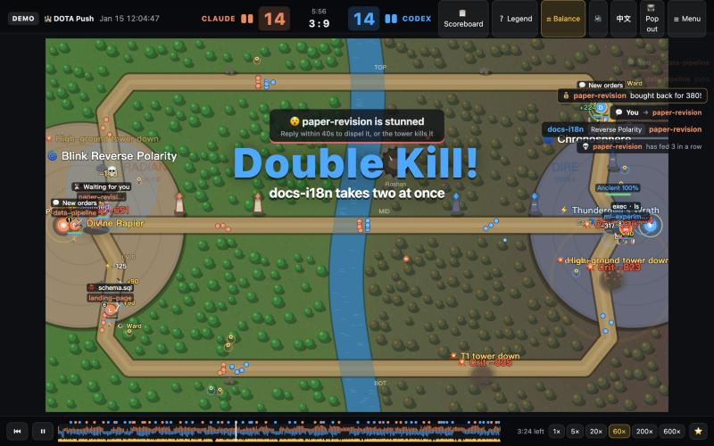
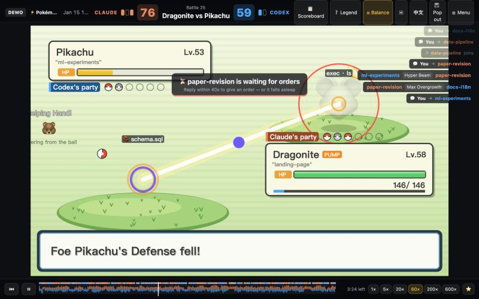
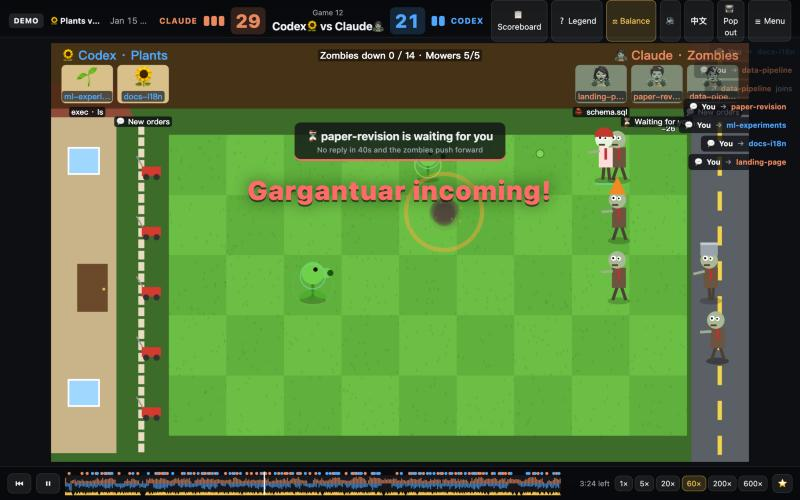
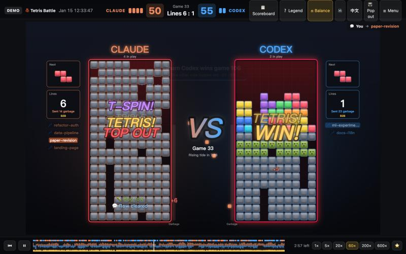
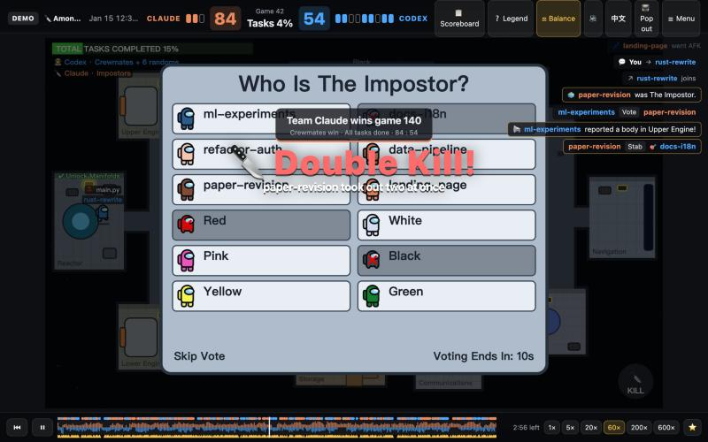
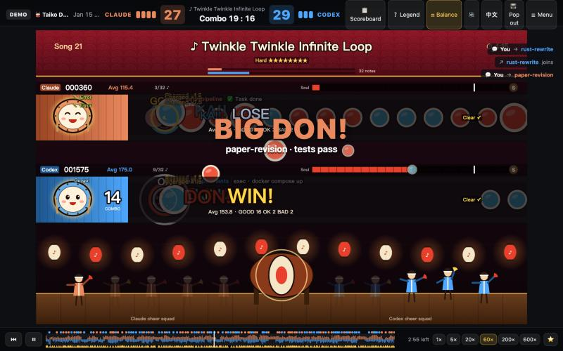
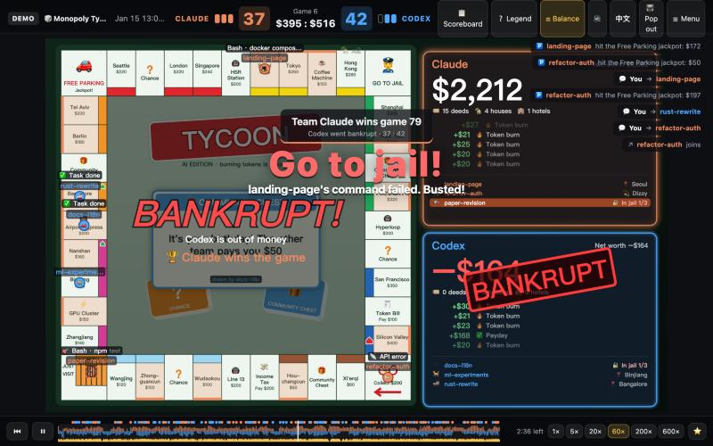
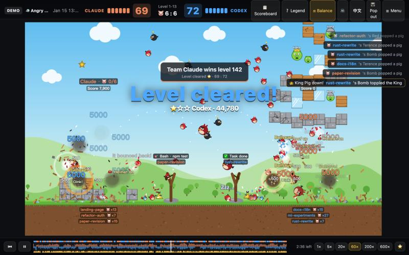
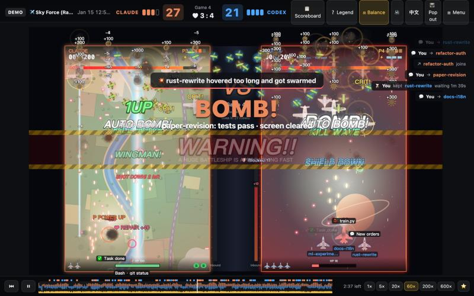

# AGENT STRIKE

**[English](#english) · [中文](#中文)**




| | | |
|---|---|---|
|  |  |  |
|  |  |  |
|  |  |  |

---

## English

Your real Claude Code and Codex sessions, replayed as a mash-up of 20 classic games.
One stream of AI events, many sets of rules: when your AI runs a command, it's a gunshot in CS,
a tower hit in DOTA, a step forward in Mario Kart, and "Claude used Bash! It's super effective!" in Pokémon.

```bash
git clone https://github.com/Polaris-Aeterna/agent-strike.git
cd agent-strike
python3 server.py
```

Then open http://127.0.0.1:8765. Only the Python 3 standard library is needed — nothing to install.
**No Claude / Codex logs on this machine?** Click **🎮 Demo** to play with a made-up day of sessions.
The UI follows your browser language; switch any time with the **中 / EN** button (or `?lang=en`).

### Games

| | Game | The best joke |
|---|---|---|
| 🎪 | **Party Mix** | A different game every stage, WarioWare-style |
| 🔫 | CS: Defuse | Passing tests are headshots; when the AI waits for you it plants the C4 — reply within 40s to defuse |
| 🏰 | DOTA Push | Context compaction = TP home, a finished task = ultimate, "Double Kill! Godlike!" |
| 🍗 | Battle Royale | Idle sessions get eaten by the blue zone. "Winner Winner, Chicken Dinner!" |
| 🏎️ | Mario Kart | Every action is a step forward; a web search is a Blue Shell for whoever leads |
| ⚡ | Pokémon Battle | "A wild Codex appeared!" "It's super effective!" |
| 🥊 | Street Fighter / KOF | Combo counters, Hadouken, Shoryuken, K.O.! |
| 🧱 | Tetris Battle | Every action drops a piece; line clears send garbage; errors grow a Bug row |
| ⛏️ | Minecraft Build-Off | Web searches lob TNT at the rival build; errors summon a Creeper. Sssss… |
| 🌻 | Plants vs. Zombies | One team plants, the other sends zombies. "The zombies ate your brains!" |
| ⚽ | Football (FIFA) | Passing tests = a worldie, a PR = bicycle kick, interrupting = red card, penalty shootouts, "SIUUU!" |
| 🥁 | Taiko Drum Master | Every action is a note; steady rhythm scores GOOD, errors are BAD, subagent bursts become drumrolls |
| 👻 | Pac-Man | One team eats dots, the other haunts; passing tests = power pellet |
| 🐍 | Slither Snake | Every session is a snake; get cut off and you become a trail of food |
| 🎲 | Monopoly Tycoon | Burned tokens are literally money; errors send you to jail; web searches draw Chance cards |
| 🔪 | Among Us | One team does tasks, the other hides an impostor — "Red was not The Impostor." |
| 🐦 | Angry Birds | Commands fling birds, passing tests send the Bomb, a PR summons the Mighty Eagle |
| 🃏 | Dou Dizhu | Fight the Landlord: passing tests = bomb, a PR = rocket, waiting too long = auto-play |
| 🦖 | Chrome Dino Run | Every action runs, errors hit a cactus, API errors show the "No internet" page |
| 🌾 | Stardew Farm-Off | Edits plant, commands water, tasks harvest; compaction = "You passed out at 2 AM…" |
| ✈️ | Sky Force (Raiden) | Shoot-'em-up versus: your kills fly over to the other side; passing tests = screen-clearing bomb |

**Only one team around?** Team games turn into a civil war: that team's sessions are split into A vs B (no points), so every game is playable even when only Claude is running.

### Matches

- **Live** — sessions active in the last 30 minutes take the field; every step your AI takes shows up instantly.
- **Replay a day** — that day's Claude sessions vs that day's Codex sessions. Idle stretches fast-forward; drag the timeline anywhere.
- **1v1 across time** — pick any Claude session and any Codex session; both start from their first move together.
- **🎮 Demo** — a made-up day, for anyone without logs.

URL shortcuts: `?game=moba&day=2026-10-09`, `?game=br&live=1`, `?demo=1`, `&lang=en`.

### Extras

- **⭐ Highlights** — every big moment (First Blood, Chicken Dinner, "the zombies ate your brains") is marked on the timeline; click one to jump there.
- **📺 Pop-out window** — float the game above all your windows while you work (Document Picture-in-Picture; desktop Chrome / Edge).

### Shared rules

- **Subagent work** counts for the session that spawned it.
- **Idle for 5 minutes** → goes AFK, rejoins on its next action.
- **Waiting for your reply / approval** starts a 40-second timer; each game plays it differently (C4, stunned, fell asleep…).
- **⚖ Balanced firepower** (on by default) scales by each team's recent activity and headcount — efficiency, not volume.

### Add a game

Every game is one file in `web/modes/`. Read [`web/modes/README.md`](web/modes/README.md), copy a mode, and test it on the demo data:

```bash
node tools/sim.mjs <id> demo           # balance
node tools/smoke.mjs <id> demo --solo  # render, no errors allowed
node tools/determinism.mjs <id> demo   # replays must be deterministic
node tools/i18n-check.mjs web/modes/<id>.js
```

GitHub Actions runs all of this on every push.

### Files

- `agentlog.py` — turns `~/.claude/projects` and `~/.codex/sessions` into one event stream.
- `server.py` — local server (127.0.0.1 only): replay data and live push.
- `web/core.js` — shared rules base; `web/i18n.js` — the `L('中文', 'English')` helper; `web/demo.js` — demo data.
- `web/modes/*.js` — one file per game, rules and visuals.
- `web/app.js` — the shell: menu, timeline, live mode, scoreboard, kill feed.
- `tools/` — balance, render, replay-determinism and translation checks.

### Privacy

Read-only: it never modifies your session logs and never uploads anything. The cache lives in `.cache/` (git-ignored); delete it to re-parse.
The game only shows tool names, file names and the first word or two of a command — never arguments — so secrets stay off screen.

---

## 中文

用你电脑上真实的 Claude Code 和 Codex 会话记录，打一场 20 个经典游戏的大杂烩。
同一条 AI 事件流，换不同的游戏规则来演：你的 AI 跑一条命令，在 CS 里是开枪，在 DOTA 里是推塔，
在马里奥赛车里是往前冲，在宝可梦里是「Claude 使用了 Bash！效果拔群！」。

```bash
git clone https://github.com/Polaris-Aeterna/agent-strike.git
cd agent-strike
python3 server.py
```

然后打开 http://127.0.0.1:8765。只需要 Python 3 自带的库，不用装任何东西。
**电脑上没有 Claude / Codex 记录？** 点 **🎮 演示**，用一份虚构的会话数据就能玩。
界面语言跟着浏览器走，随时可以用 **中 / EN** 按钮切换（或者网址加 `?lang=zh`）。

### 游戏

| | 游戏 | 最有梗的地方 |
|---|---|---|
| 🎪 | **大乱斗** | 每一关随机换一个游戏，像《瓦里奥制造》 |
| 🔫 | CS 爆破 | 测试通过 = 爆头，它等你回复时装 C4，40 秒内回它就是拆弹 |
| 🏰 | DOTA 推塔 | 上下文压缩 = 回城，任务完成 = 放大招，连杀播报「双杀！超神！」 |
| 🍗 | 绝地吃鸡 | 不干活的会话会被毒圈毒死，「大吉大利，今晚吃鸡」 |
| 🏎️ | 马里奥赛车 | 每干一次活往前跑一步，上网搜索 = 蓝龟壳专打第一名 |
| ⚡ | 宝可梦对战 | 「野生的 Codex 出现了！」「效果拔群！」 |
| 🥊 | 街霸 KOF | 连招计数、波动拳、升龙拳、K.O.！ |
| 🧱 | 俄罗斯方块 | 每次操作落一块，消行给对面送垃圾行，报错自己长一行 Bug |
| ⛏️ | 我的世界盖楼 | 上网查资料往对面扔 TNT，报错就有苦力怕「嘶嘶嘶……砰！」 |
| 🌻 | 植物大战僵尸 | 一队种植物一队放僵尸，每局交换，「僵尸吃掉了你的脑子！」 |
| ⚽ | 足球 · 实况足球 | 测试通过 = 世界波，开 PR = 倒挂金钩，你打断它 = 红牌，还有点球大战和「SIUUU!」 |
| 🥁 | 太鼓达人 | 每个动作是一个音符，干活节奏稳才是「良」，报错是「不可」，子代理狂刷变成连打 |
| 👻 | 吃豆人 | 一队吃豆一队当鬼，每局交换，测试通过 = 能量豆 |
| 🐍 | 贪吃蛇大作战 | 每个会话一条蛇，被截杀就变成一地豆子 |
| 🎲 | 大富翁 | 烧掉的 token 就是钱，报错 = 进监狱，上网搜索 = 抽机会卡 |
| 🔪 | Among Us · 太空狼人杀 | 一队做任务一队藏内鬼，开会投出来「X 不是内鬼。」 |
| 🐦 | 愤怒的小鸟 | 跑命令发射小鸟，测试通过 = 炸弹鸟，开 PR = 神鹰降临 |
| 🃏 | 斗地主 | 测试通过 = 炸弹，开 PR = 王炸，等你太久 = 自动托管，「要不起」「春天！」 |
| 🦖 | Chrome 小恐龙 | 每个动作往前跑，报错撞仙人掌，API 报错直接弹出「无法访问此网站」 |
| 🌾 | 星露谷物语 · 种田大赛 | 改代码播种，跑命令浇水，任务完成收获卖钱，压缩上下文 =「你在凌晨两点晕倒了」 |
| ✈️ | 飞机大战 · 雷电 | 竖版射击对战，打下的敌机飞到对面那边，测试通过 = 全屏炸弹 |

**只有一队在场？** 团队游戏会变成内战：把这一队的会话分成 A、B 两边打（不计分），所以只有 Claude 在跑时每个游戏也都能玩。

### 比赛

- **直播**：最近 30 分钟有动静的会话直接上场，AI 每做一步，游戏里马上有动作。
- **按天回放**：挑一天，那天所有 Claude 会话对那天所有 Codex 会话。空闲时段自动快进，进度条可以随便拖。
- **1v1 跨时空单挑**：任挑一个 Claude 会话和一个 Codex 会话，从各自开头同时开打。
- **🎮 演示**：一份虚构的会话数据，没有任何记录也能玩。

网址参数可以直接开打：`?game=moba&day=2026-10-09`、`?game=br&live=1`、`?demo=1`、`&lang=zh`。

### 额外功能

- **⭐ 高光时刻**：第一滴血、大吉大利、僵尸吃掉你的脑子……每个精彩瞬间都标在进度条上，点一下就跳过去看。
- **📺 桌面悬浮窗**：把游戏放进一个浮在所有窗口最上面的小窗口，边干活边看（文档画中画，需要电脑上的 Chrome / Edge）。

### 通用规则

- **子代理**干的活算在派它出去的主会话头上。
- **5 分钟没动静**的会话挂机下场，有动作再回来。
- **它在等你回复 / 批准**时开始 40 秒倒计时，每个游戏有自己的演法（C4、被控住、睡着了……）。
- **⚖ 均衡火力**（默认开）：按两队最近的行动频率和在场人数调整，比效率不比数量。

### 加一个新游戏

每个游戏是 `web/modes/` 里的一个文件。看 [`web/modes/README.md`](web/modes/README.md)，照着一个现成的游戏改，用演示数据测试：

```bash
node tools/sim.mjs <id> demo           # 平衡
node tools/smoke.mjs <id> demo --solo  # 画面冒烟测试，不能有报错
node tools/determinism.mjs <id> demo   # 回放必须确定
node tools/i18n-check.mjs web/modes/<id>.js
```

每次推送，GitHub Actions 都会把这些全跑一遍。

### 文件

- `agentlog.py`：把 `~/.claude/projects` 和 `~/.codex/sessions` 里的记录翻译成统一的游戏事件。
- `server.py`：本地服务器（只监听 127.0.0.1），提供回放数据和直播推送。
- `web/core.js`：所有游戏共用的规则底座；`web/i18n.js`：`L('中文', 'English')` 双语工具；`web/demo.js`：演示数据。
- `web/modes/*.js`：每个游戏一个文件，规则和画面都在里面。
- `web/app.js`：外壳（菜单、回放进度条、直播、计分板、击杀播报）。
- `tools/`：平衡、画面、回放确定性和翻译检查。

### 隐私

只读你的会话记录，从不修改它们，也不上传任何东西。缓存放在 `.cache/`（已被 git 忽略），删掉就会重新解析。
游戏里只显示工具名和文件名，命令只显示前一两个词，不显示参数，免得把密钥显示在屏幕上。

---

*Fan-made parody for fun. All game names and memes belong to their respective owners; this project is not affiliated with any of them.*
*粉丝向恶搞作品，纯属娱乐。所有游戏名称和梗归各自版权方所有，本项目与它们没有任何关系。*
